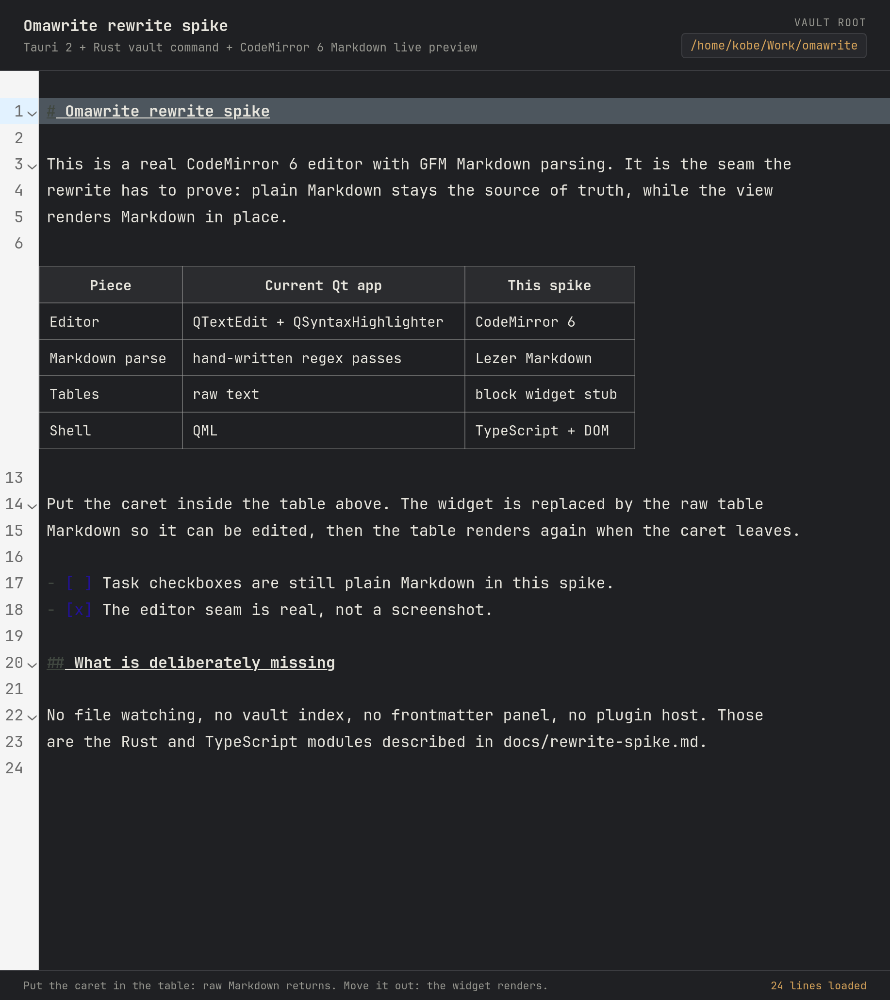

# Tauri + CodeMirror seam spike

A throwaway proof of the seam proposed in [`docs/rewrite-spike.md`](../../docs/rewrite-spike.md):

- a Tauri 2 shell;
- a Rust command, `vault_root`, that canonicalizes and returns the vault root;
- a TypeScript shell with a real CodeMirror 6 editor in GFM Markdown mode;
- one live-preview table widget: a GFM table block is replaced by an HTML table
  when the caret is outside it, and the raw Markdown returns when the caret is
  inside it.



This directory is not part of `omawrite.pro` or `tests/tests.pro`. The Qt build
and test suite do not see it.

## Requirements

- Rust 1.95 or newer (`rustc --version`). The spike was built with 1.95.0.
- Node.js 20.19+ or 22.12+ and npm. The spike was built with Node 25.8.0 and
  npm 11.11.0.
- The Tauri 2 Linux dependencies: `webkit2gtk-4.1`, GTK 3, `libsoup3`,
  `librsvg`, `base-devel`, and `openssl`. On Arch/Omarchy:

  ```sh
  sudo pacman -S --needed base-devel webkit2gtk-4.1 gtk3 libsoup3 librsvg openssl
  ```

## Run

From this directory:

```sh
npm install
npm run tauri:dev
```

`npm run tauri:dev` starts Vite itself. Do not run `npm run dev` in another
terminal at the same time; Tauri expects port 1420 and fails if it is taken.

To point the Rust command at a vault:

```sh
OMAWRITE_VAULT_ROOT=/path/to/your/vault npm run tauri:dev
```

Without the variable, `vault_root` falls back to the process working directory
and still returns a canonical absolute path.

### Other commands

```sh
# Type-check and build the frontend only.
npm run build

# Run the Rust command's unit test (canonicalization + absolute path).
cargo test --manifest-path src-tauri/Cargo.toml

# Build a Linux .deb and the release binary.
npm run tauri:build
# Artifacts: src-tauri/target/release/bundle/deb/ and src-tauri/target/release/
```

To check the editor in a plain browser, `npm run dev` then open
<http://localhost:1420/>. The vault label reads "not running under Tauri",
because there is no Tauri IPC in a browser.

## What was actually verified

Built and run on 2026-11-11 on Omarchy/Arch with:

- Rust 1.95.0, Tauri crate 2.12.5, `@tauri-apps/cli` 2.12.4
- Node 25.8.0, Vite 8.3.8, TypeScript 7.0.2
- `@codemirror/state` 6.7.6, `@codemirror/view` 6.43.15,
  `@codemirror/lang-markdown` 6.5.2, `@lezer/markdown` 1.8.1
- WebKitGTK 2.54.2

Observed:

1. `cargo build` succeeds and `cargo test` passes the `vault_root` test.
2. `npm run build` type-checks and produces a 612 KB JS bundle
   (210 KB gzip) for CodeMirror + the markdown language + this spike.
3. The Tauri window starts, and the header shows the canonical vault root
   returned by Rust (`/home/kobe/Work/omawrite` when run with
   `OMAWRITE_VAULT_ROOT=/home/kobe/Work/omawrite`).
4. The table renders as an HTML table with five rows.
5. Clicking a table cell removes the widget and reveals the raw Markdown
   (`| Piece | Current Qt app | This spike |`); clicking outside the table
   brings the widget back.
6. A headless Chromium check of the same frontend confirmed the same three
   states: rendered table, raw table after a click, rendered table after
   leaving.
7. `npm run tauri:build` produced a 1.92 MiB `.deb` and a 4.7 MB release
   binary on this machine. That is a spike-sized app using the system
   WebKitGTK, not a parity build.

## What this does not prove

- No vault indexing, backlinks, `up:` tree, file watching, search, frontmatter,
  autosave, recovery, images, print, or settings. Those are the Rust and
  TypeScript modules in the design doc, not this spike.
- No plugin host, manifest validation, capability enforcement, or sandbox.
- No mobile build.
- No memory benchmark. The 1.92 MiB `.deb` is this spike only; a parity build
  with a larger frontend and more Rust code will be bigger. The debug binary is
  179 MB because it carries debug symbols; that number says nothing about a
  release bundle.
- No rendering-parity test between WebKitGTK, WebKit, and WebView2. The table
  widget is one DOM shape, not the full editor surface.
- The table scanner is deliberately simple: it does not handle escaped pipes,
  pipes inside code spans, or tables inside blockquotes. A production
  implementation should read the table node from the Lezer syntax tree.

## Files

```text
index.html                 shell markup
src/main.ts                CodeMirror setup + invoke("vault_root")
src/table-widget.ts        state field, replace decoration, table widget
src/styles.css             page chrome
src-tauri/src/lib.rs       vault_root command + unit test
src-tauri/src/main.rs      Tauri binary entry point
src-tauri/tauri.conf.json   window, CSP, bundle config
src-tauri/capabilities/     main-window capability
```
